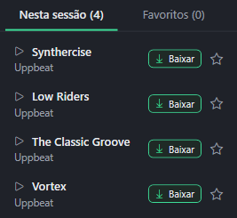
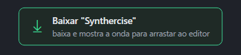

# TrackDrop

Ouça músicas e efeitos nos sites de bibliotecas, baixe o que gostar e arraste direto para a linha do tempo do seu editor de vídeo.

**[⬇ Baixar o TrackDrop para Windows](https://github.com/jluisFX/TrackDrop-download/releases/latest)**

**[⬇ Baixar o TrackDrop para Android (beta)](https://github.com/jluisFX/TrackDrop-download/releases/latest)** — arquivo **TrackDrop-Android-beta.apk**

---

## 1. Como baixar uma música

1. Abra o TrackDrop e clique numa biblioteca na coluna da esquerda (por exemplo, **Pixabay Music**).
2. No site, **clique no play da música** que você quer ouvir.
3. A música aparece na lista **"Nesta sessão"**, à direita, com o botão **Baixar**.
   Embaixo da janela também aparece o botão **Baixar "nome da música"**.
4. Clique em **Baixar**. A onda da música aparece embaixo.

> O botão Baixar só aparece **depois** que você dá play na música no site.

## 2. Como levar para o editor

- **Arraste a onda** (ou o quadro **"Arraste para o editor"**, à direita da onda) até a linha do tempo do seu editor.
- Quer só um pedaço? Toque a música, aperte **I** no começo do trecho e **O** no fim. Só esse trecho vai para o editor. **X** volta para a música inteira.

O arquivo também fica salvo em **Música\TrackDrop**.

## 3. Instalar

1. Baixe o **TrackDrop-Instalador.exe** na página de [downloads](https://github.com/jluisFX/TrackDrop-download/releases/latest).
2. Abra o arquivo. Se o Windows mostrar **"O Windows protegeu o computador"**, clique em **Mais informações** e depois em **Executar assim mesmo**.
   (O aviso aparece porque o programa ainda não tem assinatura digital.)
3. Leia e aceite os termos de uso e siga até o fim.

Precisa de Windows 10 ou 11.

## Android (beta)

Versão de teste: ainda pode ter falhas.

1. No celular, abra a página de [downloads](https://github.com/jluisFX/TrackDrop-download/releases/latest) e baixe o **TrackDrop-Android-beta.apk**.
2. Abra o arquivo. Se o celular pedir, permita **instalar apps desta origem** e toque em **Instalar**.
3. No TrackDrop, escolha **Músicas** ou **Efeitos** no topo e toque num site.
4. **Dê play na música no site.** Aí aparece o botão **Baixar**.
5. Toque em **Baixar**: a música fica salva em **Música/TrackDrop** no celular. Use **Compartilhar** para mandar para o seu editor (CapCut, InShot etc.).

Precisa de Android 7 ou mais novo.
## Dicas rápidas

- **Estrela** ao lado da música: guarda nos **Favoritos**, para usar depois sem o site.
- **Volume** no canto de baixo, à direita: vale para todos os sites e fica guardado.
- **Mais espaço para o site:** os botões nas pontas da barra de cima escondem as colunas (**Ctrl+B** e **Ctrl+J**).
- Bibliotecas pagas: faça login no site dentro do TrackDrop, como faria no navegador.

## Importante

Use só músicas e efeitos que a sua conta ou a licença do site permite usar. O TrackDrop não libera nada que o site não libere para você.
